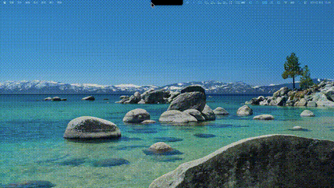

<h1 align="center">
  <br>
  <!-- 图标：请替换为 DeskPet 项目图标 -->
  
  <br>
  DeskPet
  <br>
</h1>

<p align="center">
  
  <a href="https://github.com/2048Nemo/DeskPet/releases">
    
  </a>
  
  
</p>

<!-- 预览图：请替换为 DeskPet 的 GIF/截图 -->
<p align="center">
  
</p>

---

**DeskPet** 是一款 macOS 桌面宠物应用，让你的菜单栏刘海变成一只活蹦乱跳的小猫咪 🐱。

它基于 [boring.notch](https://github.com/TheBoredTeam/boring.notch) 构建，在保留原版刘海动态岛功能（音乐控制、日历、文件暂存、HUD 替换）的基础上，新增了完整的**桌面宠物系统**：

- 🐾 **序列帧动画引擎** — 支持 24fps 高帧率动画，部分帧预缓存 + 流式补齐，内存占用极低（~200MB）
- 🏠 **回窝/出窝** — 宠物可以回刘海里睡觉，拖到刘海区域松手即瞬间进窝
- 🚶 **行为 AI** — 自主走动、打哈欠、睡觉、开心蹦跳，活动频率可自定义
- 🎵 **音乐联动** — 播放音乐时宠物会跳舞（需提供跳舞素材）
- 🖱️ **丰富交互** — 单击戳一戳、双击回窝/出窝、拖拽拎起走动、拖到刘海自动打开宠物面板
- 🎨 **可换肤** — 任意序列帧素材即可作为皮肤（支持 seeDance 等 AI 视频抽帧）
- ⚙️ **可调节** — 活动频率（Chill/Normal/Hyper + 自定义）、宠物大小、音效音量

## 📋 功能一览

### 桌面宠物（本项目新增）

| 功能 | 说明 |
|------|------|
| 序列帧动画 | PNG 序列帧，24fps，部分帧缓存 + 流式解码 |
| 行为状态机 | idle / walk / sleep / yawn / happy / hurt / drag / fall |
| 待机变体轮换 | 多套待机动画随机切换，不单调 |
| 拖拽投放刘海 | 拖宠物到刘海区域 → 自动打开宠物面板，松手瞬间进窝 |
| 回窝节能 | 回窝后卸载所有活动动画帧，内存降至 ~120MB |
| 音效系统 | 每个动作可配独立音效，音量独立可调 |

### 原版刘海功能（继承自 boring.notch）

- 🎧 音乐播放控制 + 实时可视化
- 📆 日历 / 提醒事项集成
- 📚 文件暂存架（支持 AirDrop）
- 🎚️ 系统 HUD 替换（音量 / 亮度 / 键盘背光）
- 🔋 充电指示器
- 📷 镜子（摄像头预览）

---

## 安装

### 系统要求

- macOS **14 Sonoma** 或更高
- Apple Silicon 或 Intel Mac

### 下载安装

<a href="https://github.com/2048Nemo/DeskPet/releases/latest">
  
</a>

1. 从 [Releases](https://github.com/2048Nemo/DeskPet/releases/latest) 下载 `.dmg` 文件
2. 打开 `.dmg`，将 **DeskPet** 拖到 `/Applications` 文件夹

> [!IMPORTANT]
> 本项目没有 Apple 开发者签名，首次打开会被 macOS 拦截。请在终端运行以下命令解除隔离（只需一次）：
>
> ```bash
> xattr -dr com.apple.quarantine /Applications/boringNotch.app
> ```

---

## 使用

### 桌面宠物

- **单击宠物**：戳一戳（心情好会开心蹦跳，心情差会委屈）
- **双击宠物**：回窝睡觉 / 出窝活动
- **拖拽宠物**：拎起来走动；拖到刘海区域松手 → 瞬间进窝 + 打开宠物面板
- **宠物面板**（刘海展开后 Pet 标签页）：查看心情/清洁度、抚摸、召回/出窝、调节音效音量

### 刘海动态岛

- 鼠标悬停刘海 → 展开查看音乐/日历/文件架
- 点击菜单栏图标 → 打开设置
- 拖文件到刘海 → 自动打开文件架

---

## 从源码构建

### 前置要求

- **macOS 15.6+**
- **Xcode 26+**

### 步骤

```bash
git clone https://github.com/2048Nemo/DeskPet.git
cd DeskPet
open boringNotch.xcodeproj
```

在 Xcode 中按 `Cmd + R` 构建运行。

> 也可以用命令行构建：
> ```bash
> xcodebuild -project boringNotch.xcodeproj -scheme boringNotch \
>   -configuration Release -destination 'generic/platform=macOS' \
>   CODE_SIGNING_ALLOWED=NO build
> ```

---

## 桌面宠物素材

宠物素材放在 `~/Pictures/BoringPet/` 目录下，每个动作是一个子文件夹（编号 PNG 序列帧）。

详见 **[PET.md](PET.md)** 和 **[docs/DESIGN.md](docs/DESIGN.md)**。

支持用 seeDance 等 AI 工具生成视频后抽帧作为皮肤。

---

## 🛣️ Roadmap

### 桌面宠物
- [x] 序列帧动画引擎 + 行为 AI
- [x] 回窝/出窝 + 拖拽投放刘海
- [x] 部分帧预缓存 + 流式补齐（低内存）
- [x] 多套待机变体轮换
- [x] 活动频率 / 音效音量自定义
- [ ] 更多行为（吃东西、玩耍、互动小游戏）
- [ ] 皮肤市场 / 社区分享
- [ ] 多宠物同时饲养

### 继承自原版
- [x] 音乐控制 + 可视化
- [x] 日历 / 提醒 / 文件架 / HUD 替换
- [ ] 蓝牙设备活动
- [ ] 天气集成

---

## 🤝 致谢

本项目基于开源项目 **[boring.notch](https://github.com/TheBoredTeam/boring.notch)** 构建，感谢原项目作者 [TheBoredTeam](https://github.com/TheBoredTeam) 的杰出工作。

### 依赖的开源项目
- **[boring.notch](https://github.com/TheBoredTeam/boring.notch)** — 刘海动态岛核心（GPLv3）
- **[MediaRemoteAdapter](https://github.com/ungive/mediaremote-adapter)** — macOS 15.4+ 媒体控制
- **[NotchDrop](https://github.com/Lakr233/NotchDrop)** — 文件架功能参考

本项目继承 GPLv3 协议开源。

---

<p align="center">
  Made with 🫶🏻 for cat lovers
</p>
